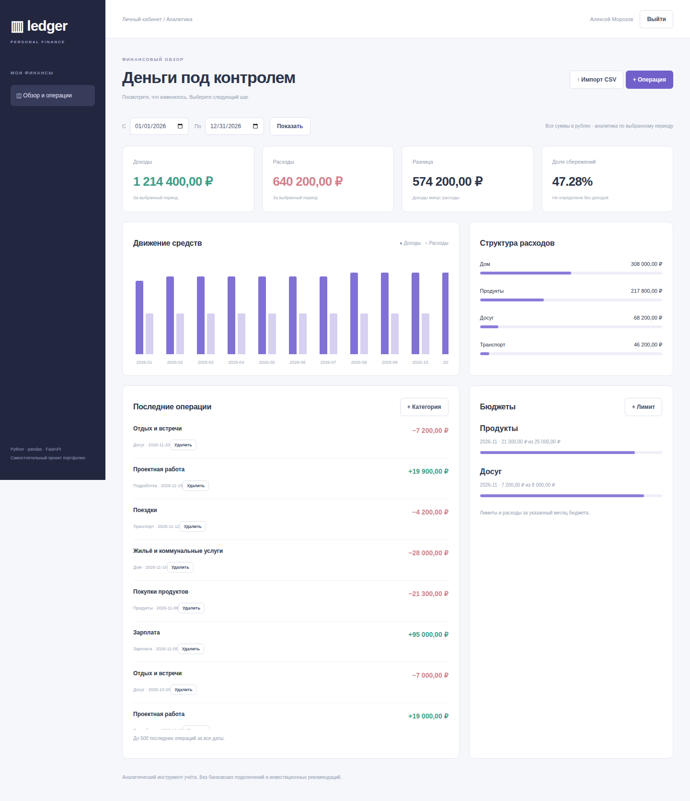

# Ledger Finance Dashboard

Самостоятельный учебный Python MVP: доходы и расходы, категории, бюджеты, атомарный CSV-импорт, SQL-аналитика и сравнение периодов. FastAPI, SQLAlchemy, Alembic, PostgreSQL и pandas для CSV-экспорта; адаптивный JavaScript-интерфейс. Платные услуги и банковские подключения не используются.

## Локальный запуск новой базы

Python 3.12–3.14, отдельное окружение. Установите `python -m pip install -r requirements.lock`, затем:

```sh
python -m alembic upgrade head
python -m app.seed --email demo@example.test
uvicorn app.main:create_app --factory --no-access-log --host 127.0.0.1 --port 8002
```

Откройте http://localhost:8002. Пароль вымышленного демо-аккаунта вводится локально через getpass; встроенных общих паролей нет. Seed создаёт 66 вымышленных операций и не перезаписывает существующий аккаунт. Можно зарегистрировать собственный пустой аккаунт через интерфейс. Для старой базы сначала прочитайте [инструкцию миграций](docs/MIGRATIONS.md): upgrade требует предварительной сверки и stamp 0001.

## Docker и PostgreSQL

Создайте исключённый из Git .env с POSTGRES_PASSWORD из случайных букв и цифр. `docker compose up --build -d`, затем `docker compose exec dashboard python -m app.seed --email demo@example.test`. Данные находятся в именованном томе, интерфейс доступен на localhost:8002. Не используйте down -v для остановки с сохранением данных. HTTPS требует собственного TLS proxy, ENVIRONMENT=production и APP_ORIGIN; одно это не делает MVP production-сервисом.

## Отчёты и проверки

SQL GROUP BY/SUM/COUNT выполняются в БД, суммы — целые копейки. Сравниваются равные по числу дней периоды; при нулевой базе процент не определяется. Экспорт отчёта формирует CSV из месячных агрегатов через pandas, без загрузки всей истории в память.

`pytest -q`: локально Python3.14 — 14 passed, 2 skipped (нет PostgreSQL). CI настроен на Python3.12/3.13/3.14 с отдельной PostgreSQL-схемой, проверкой BigInteger и владельцев; Docker/runtime и Chromium проверяют интерфейс и сохранность данных. Результаты конкретных запусков: [ACCEPTANCE.md](docs/ACCEPTANCE.md). Для качества: установите requirements-quality.txt, запустите `python -m ruff check app tests scripts` и `python -m mypy`. Ruff E9/F проверяет приложение, тесты и скрипты; strict mypy пока проверяет app/periods.py.

## Ограничения

Только RUB, без банковской синхронизации, конвертации валют и инвестиционных рекомендаций. Разница доходов и расходов не означает банковский остаток. Список показывает до 500 последних операций, агрегаты охватывают весь выбранный период. Отчёт не гарантирует единый снимок при конкурентных изменениях между SQL-запросами. Нет восстановления пароля, общего распределённого limiter и подтверждённых нагрузочных гарантий. Аварийное восстановление и production-эксплуатация не считаются проверенными.

[Архитектура](docs/ARCHITECTURE.md) · [REST API](docs/API.md) · [Отчёты](docs/REPORTS.md) · [Миграции](docs/MIGRATIONS.md) · [Другие проекты](docs/PORTFOLIO.md)



[Мобильный экран](docs/screenshots/dashboard-mobile.png)


[Readiness, JSON-логи и проверка backup/restore](docs/OPERATIONS.md).


[Видеодемонстрация и обзорные кадры](docs/demo/README.md).


## List pagination

GET list endpoints accept limit (1..100, default50) and offset (0..10000000). Responses remain JSON arrays with X-Total-Count scoped to the signed-in owner; CRM deal totals also respect stage. Stable order: descending ID for CRM; occurred_on descending, ID descending for Ledger. UI loads50 at a time with Show more. Aggregates still cover all records. Offset pagination is not a snapshot: concurrent inserts/deletes can shift pages. Refresh resets the loaded list.
